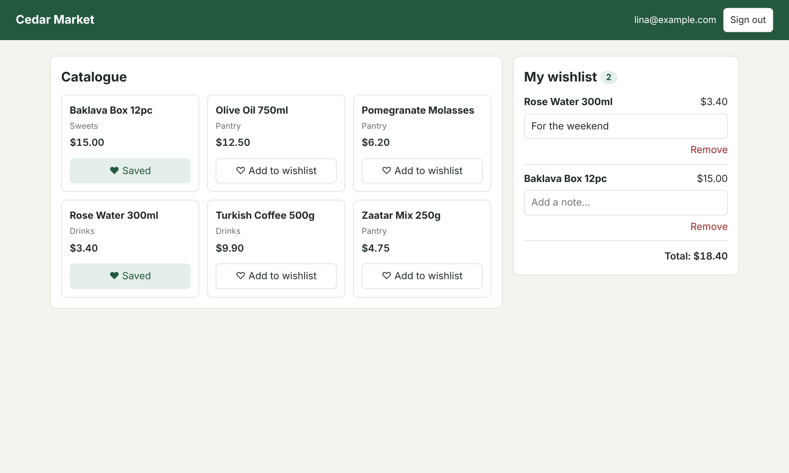

# Cedar Market — Wishlist (Firebase)

A customer wishlist for an online store, built on **Firebase Authentication, Cloud Firestore and Firebase Hosting**.
Shoppers sign in, save products, add a note to each one, and see changes instantly on every device.



## Features

- Email/password sign-in and registration, plus guest (anonymous) sign-in
- Product catalogue read live from Firestore
- Private wishlist per user at `users/{uid}/wishlist/{productId}` with real-time updates
- **Security rules** that enforce the data model on the server:
  - the catalogue is public and read-only
  - a user can only read and write their own wishlist
  - an item must point to an existing product and contain only the allowed fields
  - after saving, only the note can be edited (max 140 characters)
- **9 automated security-rule tests** that run against the Firestore emulator
- Runs fully offline on the Firebase Emulator Suite — no Firebase account needed to try it

## Tech

Firebase Auth · Cloud Firestore · Security Rules · Firebase Hosting · Emulator Suite ·
JavaScript (ES modules, no framework) · `@firebase/rules-unit-testing` · Node test runner

## Run it locally

Requires Node 20+ and Java 11+ (for the emulators).

```bash
npm install
```

```bash
npm start
```

Open http://127.0.0.1:5000. The emulators start with a seeded catalogue; register with any email and password.

```bash
npm test
```

## Deploy to your own Firebase project

1. Create a project in the Firebase console, enable **Authentication** (Email/Password and Anonymous) and **Firestore**.
2. Put your web app config in `public/firebase-config.js` and your project id in `.firebaserc`.
3. Add the products to the `products` collection (fields: `name`, `category`, `price`).
4. Deploy:

```bash
npm run deploy
```

## Project structure

```
public/            Hosting root: index.html, app.js, styles.css, firebase-config.js
firestore.rules    Security rules
test/              Security-rule tests
scripts/seed.js    Loads the catalogue into the emulator
firebase.json      Hosting, Firestore and emulator configuration
```
